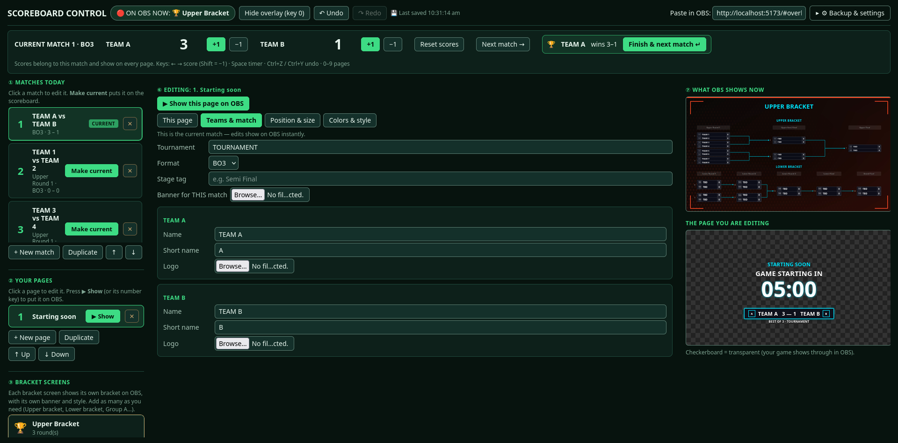
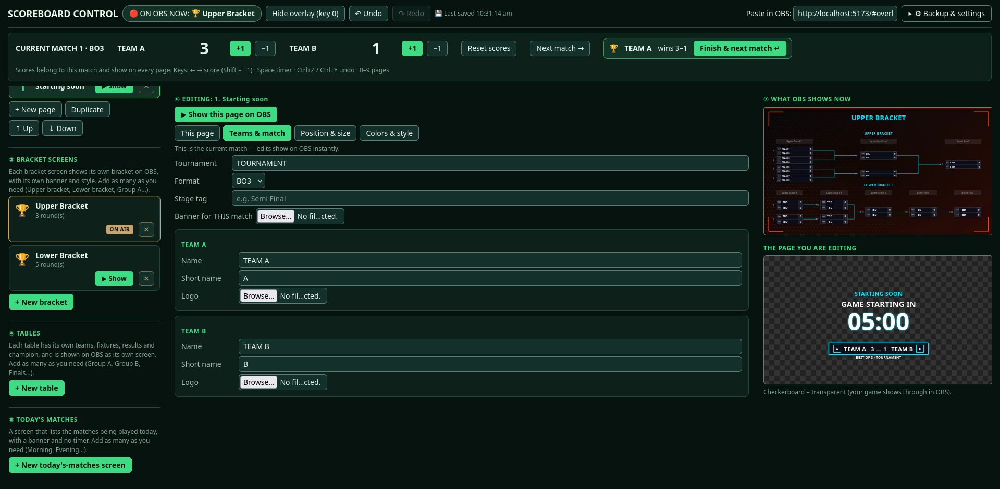
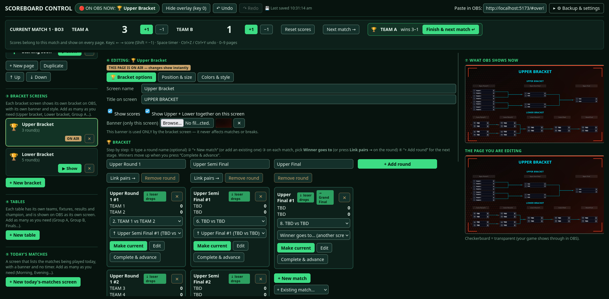
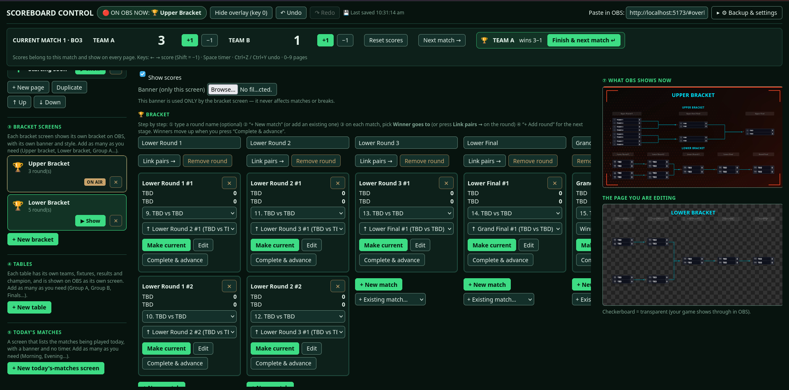
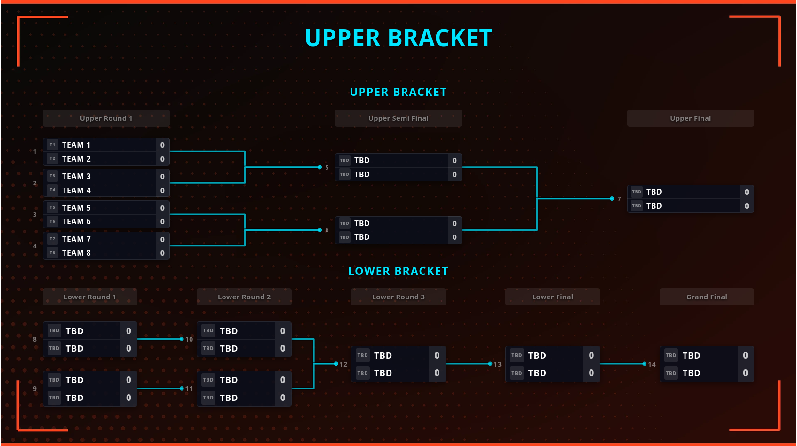
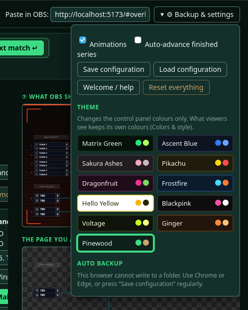

# 🎮 Esports Scoreboard Overlay

A customizable **esports scoreboard and broadcast overlay** for **OBS Studio, Streamlabs Desktop and YouTube/Twitch live streaming**.

It has two parts: a **Control panel** where you manage teams, scores, matches, countdowns, pages, brackets, tables and styling, and a clean, transparent **Overlay** that OBS shows on stream. It runs entirely on your own computer, with no account and no paid service.

---

## 📑 Table of contents

- [Features at a glance](#-features-at-a-glance)
- [Screenshots](#-screenshots)
- [Download and run](#-download-and-run)
- [Using it with OBS Studio](#-using-it-with-obs-studio)
- [How it works](#-how-it-works)
- [Detailed features](#-detailed-features)
- [Keyboard shortcuts](#-keyboard-shortcuts)
- [Saving, backups and safety](#-saving-backups-and-safety)
- [Troubleshooting](#-troubleshooting)
- [Tech stack](#-tech-stack)
- [Use cases](#-use-cases)
- [Future improvements](#-future-improvements)
- [Contributing](#-contributing)
- [License](#-license)

---

## ✨ Features at a glance

- 🎥 OBS Studio and Streamlabs Desktop Browser Source support
- 🏆 Professional esports-style scoreboard
- 👥 Team names, short names and logos
- 🔢 Live score controls with buttons and keyboard shortcuts
- 🎮 BO1, BO3, BO5 and BO7 series with automatic series-winner detection
- ⏭️ "Finish & next match" and optional auto-advance
- 📋 Unlimited matches, with a "current match" you can switch at any time
- 🏷️ Stage tags (Group Stage, Semi Final, Grand Final…)
- 🖼️ Break pages, image-only banner pages, brackets, group tables and a "today's matches" screen
- ⏱️ Countdown timers: set a duration, or count down to a clock time
- 🎨 Fonts, colors, borders, glow, shadows, opacity and one-click Quick Looks
- 📐 Independent position and size for every element on a 1920×1080 canvas
- 👀 Live previews of what OBS shows and what you are editing
- ↶ Undo / redo
- 💾 Automatic saving, plus backup folder and import/export
- 🔄 Real-time updates in OBS
- 🎬 Optional animations
- 🌐 Runs locally, free

---

## 📸 Screenshots
     
### Control panel


### Overlay in OBS


---

## 🚀 Download and run

Every package the project needs is listed with its version in [`src/requirements.txt`](src/requirements.txt). You install **Node.js once**, and one command (`npm install`) downloads all the rest.

### 1. Download the project (ZIP)

1. Open <https://github.com/Divyansh-3/LIVE-SCORE>
2. Click the green **Code** button → **Download ZIP**.
3. Extract the ZIP (right-click → **Extract All** on Windows, double-click on macOS). You get a folder named `LIVE-SCORE-main`.

### 2. Install Node.js (once)

Install the **LTS** version from <https://nodejs.org>, or use your system's command:

| System                          | Command                                             |
| ------------------------------- | --------------------------------------------------- |
| **Windows** (CMD or PowerShell) | `winget install OpenJS.NodeJS.LTS`                  |
| **macOS** (Homebrew)            | `brew install node`                                 |
| **Ubuntu / Debian**             | `sudo apt update && sudo apt install -y nodejs npm` |
| **Fedora**                      | `sudo dnf install -y nodejs npm`                    |
| **Arch**                        | `sudo pacman -S nodejs npm`                         |

Close and reopen your terminal afterwards, then check it works:

```bash
node -v
npm -v
```

### 3. Install and run

Open a terminal **inside the `src` folder** of the extracted project (it contains `package.json` and `requirements.txt`), then run the commands for your system.

#### 🪟 Windows

Open the extracted folder, open `src`, click the address bar, type `powershell` and press Enter. Then:

```powershell
npm install
npm run dev
```

Or from any PowerShell window (if the ZIP is in Downloads):

```powershell
cd "$HOME\Downloads\LIVE-SCORE-main\src"
npm install
npm run dev
```

#### 🍎 macOS

```bash
cd ~/Downloads/LIVE-SCORE-main/src
npm install
npm run dev
```

#### 🐧 Linux

```bash
cd ~/Downloads/LIVE-SCORE-main/src
npm install
npm run dev
```

(If you downloaded the ZIP from the terminal: `unzip LIVE-SCORE-main.zip`, then `cd LIVE-SCORE-main/src`.)

#### Install from `requirements.txt` instead (optional)

`requirements.txt` lists the exact versions of every package. `npm` cannot read that format directly, so these commands convert it for you. Run them inside `src`, **then** `npm run dev`:

```powershell
# Windows (PowerShell)
npm install --no-save (Get-Content requirements.txt | ForEach-Object { $_ -replace '==','@' })
```

```bash
# macOS / Linux
npm install --no-save $(sed 's/==/@/' requirements.txt)
```

`--no-save` installs those exact versions without changing `package.json`.

### 4. Open it

Go to **<http://localhost:5173>** in Chrome or Edge.

- **Keep the terminal window open while you stream.** Closing it stops the scoreboard.
- **Next time**, you only need `npm run dev`: open a terminal in `src` and run it. `npm install` is only needed the first time.
- `npm run dev` already locks the port to `5173` on purpose. Browsers keep your data per address, so if the port changed, your tournament would seem to disappear. If the port is busy, close the other copy of the app first.

The first time you run it on your own computer, a step-by-step **Welcome guide** opens automatically. You can reopen it from **⚙ Backup & settings → Welcome / help**.

---

## 🎥 Using it with OBS Studio

The app has two addresses on the same site:

| Page        | Address                          | Purpose                        |
| ----------- | -------------------------------- | ------------------------------ |
| **Control** | `http://localhost:PORT/`         | Where you click and type       |
| **Overlay** | `http://localhost:PORT/#overlay` | What viewers see (transparent) |

The Control page shows the exact overlay link in the **"Paste in OBS"** box at the top.

### Step 1: Add the overlay

1. In OBS, under **Sources**, click **+ → Browser**.
2. Name it "Scoreboard" and click OK.
3. Paste the overlay link into **URL**.
4. Set **Width 1920** and **Height 1080**.
5. Leave **Custom CSS** unchanged. The background is already transparent.
6. Click OK and place the source above your game capture.

### Step 2: Open Control inside OBS (important)

OBS Browser Sources use OBS's own built-in browser, which keeps its own separate storage. The overlay reads the data saved by the Control page, so **Control must run in the same OBS browser**, not in Chrome or Edge.

1. In OBS, open **Docks → Custom Browser Docks…**
2. Name it "Scoreboard Control" and paste the Control address (the same address as the overlay, without `#overlay`).
3. Click **Apply**. The control panel now appears as a dock inside OBS.
4. Run your whole show from that dock.

> ⚠️ Use the **exact same address** for the dock and the overlay. `localhost` and `127.0.0.1` are treated as different sites with separate storage, so do not mix them.
>
> If you control the scoreboard from a normal Chrome or Edge window, the overlay in OBS will **not** update.

In Streamlabs Desktop, use its custom browser dock option if your version has one.

---

## 🧠 How it works

- **Matches** hold team names, logos, format (BO1–BO7), stage and the score. One match is the **current match**.
- **Pages** are screens. Only one page is **on air** at a time, or none (overlay hidden).
- The **score belongs to the match**, so it shows on every page that displays that match.
- Every change is broadcast to the overlay within about 40 ms and saved to your browser's IndexedDB database shortly after.
- The top bar always shows what OBS is displaying right now.

---

## 🔍 Detailed features

### 🏆 Match management

- Create as many matches as you need, and **duplicate**, **reorder** and **delete** them.
- Click a match to edit it, and press **Make current** to put it on the scoreboard.
- Prepare upcoming matches while the current one is being played. A warning shows when you are editing a match that is not on stream.
- Per match: **tournament name**, **format** (BO1, BO3, BO5, BO7), **stage tag**, an optional **match banner**, and for each team a **name**, **short name** and **logo**.

Example:

```text
Match 1   Phantom Wolves vs Shadow Force   BO3   Quarter Final
Match 2   Team Alpha vs Team Omega         BO5   Semi Final
Match 3   Team Red vs Team Blue            BO3   Grand Final
```

### 🔢 Scoring and series

- **+1 / −1** buttons for each team in the strip at the top, always visible.
- Keyboard scoring with the arrow keys (no mouse needed).
- **Reset scores** and **Next match →** controls.
- When a team wins the series (for example 2–0 in a BO3), a banner appears with **Finish & next match**. It moves on to the next match.
- Optional **Auto-advance finished series**: waits a few seconds so viewers can see the final score, then moves on. Undo cancels it.
- Scores can never go below 0.

### 📄 Pages (break screens)

Each page is a screen you can put on air. A normal page can show:

- A **big title**, a **line above the timer**, and a **"when timer hits 0"** message
- An **info line** (for example "Next map: Bind")
- A **countdown** and/or a **scoreboard** (each can be switched on or off)
- A **default banner** image
- A **match shown** setting: follow the current match automatically, or lock the page to one specific match

You can add, duplicate, reorder and delete pages. Pages are numbered, and the number keys put them on air.

### 🖼️ Banner pages

An **image-only** page that shows one picture and nothing else: no title, countdown or scoreboard. Choose **Fill the screen** (may crop) or **Show the whole image**, and use Position & size to move or resize it.

### ⏱️ Countdown timers

Every page that shows a countdown has its own timer:

- **Start**, **Pause**, **Resume** and **Reset**
- **+10s / −10s**, even while it is running
- Quick presets: 00:30, 01:00, 02:00, 05:00
- **Custom time** such as 03:30
- **Count down to a clock time** (24-hour, for example 22:00 = 10 PM). If that time has already passed today, it counts to tomorrow.
- **Space** starts or pauses the timer of the page that is on air

### 🏆 Bracket screens

- Add as many bracket screens as you need (Upper bracket, Lower bracket, Group A…).
- Each screen has its own title, banner, layout and style.
- Bracket slots are linked to your matches.
- Option to **show scores** and, for double-elimination brackets, to **show Upper and Lower together** on one screen.
- Deleting a match used by a bracket warns you first and leaves that slot empty until you pick another match.

### 📊 Table screens

- Group-stage tables with their own teams, fixtures and results.
- Shows a **champion** when the table is complete.
- The Control list shows progress such as "4 teams · 3/6 played".
- Add as many as you need and **duplicate** a table (Group A → Group B) with one click.
- Each table has its own title, banner, layout and style.

### 🗓️ Today's matches screen

A screen that lists the matches being played today, with a banner and **no timer**. Add several (Morning, Evening…) with their own titles, subtitles and an optional **show scores** setting.

### 📐 Position and size

- The canvas is **1920×1080**.
- Every element has its own **X, Y and Size**, and an element can be **hidden** with its "show" checkbox.
- Elements include: plate, tournament name and logo, match info, map, team logos, names and scores, countdown, banner, break title and subtitle, scoreboard and info line.
- Bracket, table and list screens also get **Width / Height** and **Shift** buttons (±10, ±50, up, down) plus **Center**, which centers the block without changing its size.
- A **background image** per page, with its own size %, X and Y.

### 🎨 Colors and style

- **Font** (type any installed font, with suggestions), **weight** and **letter spacing**
- Colors for **text, team names, score/timer, accent/border and panel**
- **Panel opacity, border width, corner radius, glow, shadow** and **overall opacity**
- **Quick Looks**: ready-made styles you can apply to the current page or **ALL pages** (texts, images and scores are kept, only the style changes)
- **Save current look as Custom** and reuse it on other pages
- A theme picker for the Control panel itself
- Optional **animations** (on/off)

> Fonts must be installed on the computer running OBS. If one doesn't appear, pick another.

### 🖼️ Images

- Logos, banners and backgrounds are resized automatically in your browser. Logos are limited to 512 px and other images to 1920 px.
- **PNG and WEBP transparency is preserved.**
- Images are stored inside your saved data, so they are not limited by the small browser localStorage quota.

### 👀 Live previews

Two previews sit beside the controls: **What OBS shows now** and **The page you are editing**. A checkerboard means transparent.

### ↶ Undo and redo

- Up to 30 steps of undo and redo for edits, with quick bursts of typing grouped into one step.
- Scores always get their own step.
- Undo **never changes what is on air or your running timers**, so it is safe to use during a live stream.
- Even a full import or reset can be undone.

---

## ⌨️ Keyboard shortcuts

Shortcuts are ignored while you type in a text box.

| Key                        | Action                                       |
| -------------------------- | -------------------------------------------- |
| `←` / `→`                  | +1 for Team A / Team B                       |
| `Shift` + `←` / `→`        | −1 for Team A / Team B                       |
| `Space`                    | Start or pause the on-air countdown          |
| `1` – `9`                  | Put that numbered page on air                |
| `0`                        | Hide the overlay                             |
| `Enter`                    | Finish a won series and go to the next match |
| `Ctrl+Z`                   | Undo                                         |
| `Ctrl+Y` or `Ctrl+Shift+Z` | Redo                                         |

---

## 💾 Saving, backups and safety

- **Autosave**: every change is saved within a moment. The top bar shows "Last saved", and a red warning appears if saving fails.
- **Persistent storage**: the app asks the browser not to delete its data when space runs low.
- **Save / Load configuration**: export your entire tournament as a `.json` file and load it on any computer.
- **Automatic backup folder** (Chrome / Edge): choose a folder once and backups are written there automatically, with a dated copy every 30 minutes (the last 12 are kept). This may not be available inside OBS's built-in browser, so also use **Save configuration** before big events.
- **Multi-tab safety**: if the Control page is open in two tabs, the newer state always wins and an old tab can never overwrite newer data.
- **Fallback mode**: if the browser blocks storage (for example a private window), you can continue without saving and export backups manually.
- **Reset everything** erases all matches, pages and images (with confirmation, and undoable).

---

## 🩺 Troubleshooting

| Problem                         | Fix                                                                                                                                                                                                              |
| ------------------------------- | ---------------------------------------------------------------------------------------------------------------------------------------------------------------------------------------------------------------- |
| OBS shows nothing               | Check the top bar says "ON OBS NOW". Press **▶ Show** on a page.                                                                                                                                                 |
| Overlay shows but never updates | You are controlling from Chrome/Edge. Use the **Control dock inside OBS** (see above), and make sure both addresses match exactly. Then right-click the source → **Properties → Refresh cache of current page**. |
| My data disappeared             | Control and the overlay used different browsers, so they have different data. Load your saved configuration in the dock.                                                                                         |
| The overlay is cut off          | Make sure the Browser Source is **1920×1080**.                                                                                                                                                                   |
| A font looks different          | It is not installed on that PC. Pick another font.                                                                                                                                                               |
| A shortcut does nothing         | You may be typing in a text box. Click an empty area first.                                                                                                                                                      |
| "Database is blocked"           | Close other copies of the app, or continue without saving and export backups often.                                                                                                                              |

---

## 🛠️ Tech stack

- **React**
- **TypeScript**
- **Vite**
- **CSS**
- **IndexedDB**: saves your tournament and images on your computer
- **BroadcastChannel API**: instant updates between Control and the overlay
- **File System Access API**: optional automatic folder backups (Chrome / Edge)

---

## 📌 Use cases

- Esports tournaments
- Gaming livestreams
- YouTube broadcasts
- Twitch streams
- Community tournaments
- College esports events
- LAN events
- Tournament organizers
- Custom gaming broadcasts

---

## 🔮 Future improvements

- Automatic game result integration
- Game API integrations
- Player statistics
- Round/map statistics
- Remote control panel
- Cloud synchronization
- Multiple overlay themes
- Sponsor/advertisement slots
- Stream alerts
- Animated team introductions

---

## 🤝 Contributing

Contributions, suggestions and improvements are welcome.

If you find a bug or have an idea for a new feature, feel free to [open an issue](https://github.com/Divyansh-3/LIVE-SCORE/issues/new) or submit a pull request.

---

## 📄 License

This project is currently available for personal and educational use.

If you plan to use it commercially, please check the repository license and project dependencies before doing so.

---

### ⭐ If you find this project useful

Consider giving the repository a **star ⭐** and sharing it with other esports creators and tournament organizers.
